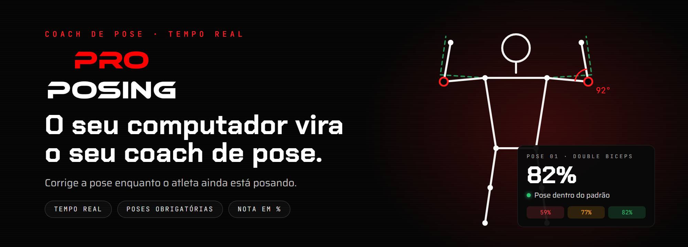

### O seu computador vira o seu coach de pose.

O **proPosing** treina posing de fisiculturismo com feedback em tempo real. A câmera filma o atleta, a visão computacional acha os pontos do corpo, compara com a pose de referência e mostra na tela o que ajustar, **enquanto o atleta ainda está posando**.

| 📷 Câmera | 🦴 Pontos do corpo | 📐 Comparação | 🖥️ Na hora |
|---|---|---|---|
| Filma o atleta ao vivo | A visão computacional acha ombros, cotovelos, quadril e o resto | Ângulos e alinhamento contra a pose de referência | Nota em % e o ajuste na tela |

#### Do erro à pose validada

| 🔴 59% | 🟡 77% | 🟢 82% |
|---|---|---|
| "Suba os dois cotovelos" | "Iguale a flexão dos dois cotovelos" | Pose dentro do padrão |

#### Por que existe

Treinar posing ainda depende de acompanhamento especializado, que custa caro para o atleta amador e para o entusiasta. E a correção costuma chegar depois, quando a pose já passou. O proPosing leva o feedback para o momento em que ele serve: **durante a pose**.

#### Onde estamos

- 🖥️ **Desktop (Windows):** piloto fechado, com licença por instalação e treino offline. Ainda não está à venda.
- 📱 **Mobile:** em desenvolvimento.

---

Um produto da **[SABINVS PRODUCTIONS](https://github.com/sabinvs)**, estúdio de tecnologia e entretenimento de Goiânia. 
*A criatividade é a força principal da alma.*
